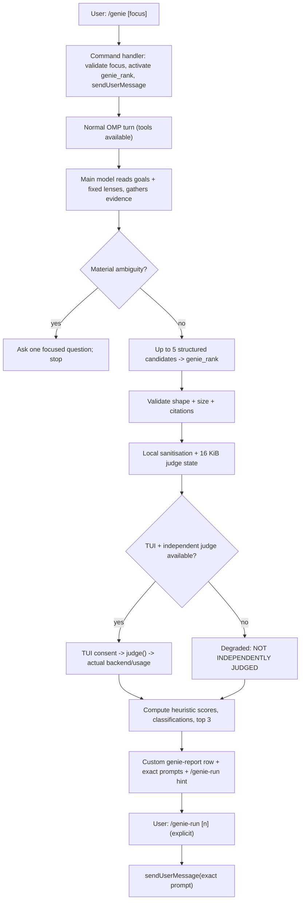

# OMP Genie architecture

Status: design for OMP 19.2.1. Phase 0 evidence: [`verification.md`](./verification.md).
No implementation is claimed by this document.

## 1. Product boundary

Genie is a user-invoked OMP extension that answers one question:

> Given this project and what its owner appears to be trying to do, what deserves attention next,
> and what exact prompt should I run to investigate or address it?

It is not a code reviewer, task runner, autonomous agent, Jev wrapper, MCP server, or replacement for
OMP's tools. It never edits project files, commits, opens PRs, installs dependencies, or runs a
recommendation without an explicit user command.

## 2. Flow



## 3. Host APIs

All citations are OMP `v19.2.1` (`b55cd1bb664d8ab46ddc77f2a34eb47555dbf1ac`).

| Need | API | Evidence | Compatibility |
| --- | --- | --- | --- |
| Register commands | `pi.registerCommand(name, { handler })` | `types.ts:1859-1863`, `2098-2107` | Public extension API |
| Start a normal tool-capable turn | `pi.sendUserMessage(text, { attribution: "agent" })` when idle | `docs/extensions.md:399-408`; `agent-session.ts:11664-11715`; `agent-session-types.ts:576-580` | Public; verified |
| Register ranking tool | `pi.registerTool(...)`; `execute(..., ctx: ExtensionContext)` | `types.ts:1052-1101` | Public |
| Activate tool only for a Genie run | `pi.getActiveTools()` / `pi.setActiveTools(names)` | `types.ts:2248-2255` | Public |
| Read project paths | `ctx.cwd` | `types.ts:838-839` | Public |
| Show consent / picker | `ctx.ui.confirm` / `ctx.ui.select`; gate on `ctx.mode === "tui" && ctx.hasUI` | `types.ts:393-394`, `825-849`; `docs/extensions.md:1044-1049`, `1245-1247` | Public; TUI only for this feature |
| Resolve/inspect judge | `resolveJudge({settings, registry, sessionModel, sessionId, purpose})` | `judgment/index.ts:459-461`; `JudgeDeps` `97-135` | **Internal package export** `package.json:360-363`; version-gated |
| Live session settings for judge | `ctx.modelRegistry.mirrorInputs().settings` | `model-registry.ts:881-883`, `5268-5277` | Public accessor returning internal shape; version-gated |
| One judge request | `judge.withCandidate(...)` / `judge.judge({state, questions})` | `judgment/index.ts:510-578`; `packages/ai/src/judgment/types.ts:116-143` | Internal adapter only |
| Actual backend + usage | `JudgmentResult { api, provider, model, answers, usage }` | `judgment/index.ts:1023-1029`; `types.ts:123-130` | Available only when judge ran |
| Stop after suitable results | `pi.sendUserMessage` from `/genie-run` | same as above | Public |

**Version boundary.** Core extension APIs: tested on `19.2.1`; declared support `>=19.2.1 <20`.
Judge adapter: tested only on `19.2.1` initially; allowed only when `VERSION` starts with `19.2.`
and the runtime capability checks pass. Anything else disables independent judgement with a visible
reason; the core report still works. No `main`-branch API is assumed.

## 4. Command behaviour

### `/genie [focus]`

- Run only in the main session: if `ctx.agent.kind !== "main"`, notify that Genie is main-session
  only and stop. The tool rejects subagent calls for the same reason.
- Focus: empty (all lenses) or one of `architecture`, `security`, `performance`, `roadmap`, `tests`,
  `dependencies`. Unknown values are rejected with the allowed list; no turn starts.
- `await ctx.waitForIdle()` before starting.
- Capture whether `genie_rank` is already active. If not, add it to the active set only for this run.
  Register the tool with `defaultInactive: true` so normal turns do not carry its schema.
- Send the contents of `prompts/genie.md` with the focus interpolated, `attribution: "agent"`, via
  `pi.sendUserMessage`. Catch `PromptDroppedError`/other errors, restore the tool set, and notify.
- On a terminal `agent_end` (`!event.willContinue && !event.awaitingAsyncWork`), remove `genie_rank`
  if this run activated it. Do not remove a tool the user had already activated.

### `/genie-run [1-3]`

- Run only in the main session (`ctx.agent.kind === "main"`).
- Requires a prior result for the current session; otherwise notify.
- With an index, use it directly. Without an index, show `ctx.ui.select` with the top-three titles.
- Only TUI (`ctx.mode === "tui" && ctx.hasUI`) offers the picker. Other modes only display the prompts
  from the report and tell the user to copy one.
- Send the selected exact prompt through `pi.sendUserMessage`; never auto-run and never modify files.
- The last result is held in an in-memory map keyed by session id. It is cleared on session
  switch, clear, and shutdown. It is not a database, not persisted, and not a recommendation cache
  across sessions.

## 5. Evidence gathering

`prompts/genie.md` instructs the main model to:

1. Read the project's self-description first: `README*`, docs/roadmap, `AGENTS.md`/`CLAUDE.md`,
   package manifests, `git status --short`, and recent `git log --oneline`. Read-only `gh issue list`
   / `gh pr list` only if already configured and authenticated; otherwise mark issues unavailable.
2. State the apparent goals in about three lines and distinguish inspected sources from unavailable
   ones. If an ambiguity would materially change the recommendations, ask one focused question and
   stop without calling `genie_rank`. Otherwise proceed with explicit assumptions.
3. Sweep the nine fixed lenses: correctness, security, architecture, performance, tests/CI,
   documentation, dependencies, roadmap/intent, release/operations. Classify each as:
   `finding`, `no_finding`, `not_inspected`, or `not_applicable`.
   "No finding" is not "clean"; the report says what was inspected.
4. Propose at most five candidates. Each must be project-specific and evidence-backed. Generic
   advice is penalised. Evidence should cite paths and line ranges; if exact lines are unavailable,
   say so rather than inventing them.
5. Call `genie_rank` exactly once with the goals, lens coverage, assumptions, and candidates.
6. Present the tool's report. Do not add new findings or re-rank after the tool returns.

The model may use normal OMP tools. It may not install packages, modify files, commit, push, run
network scans, or make background calls. Issue reads via `gh` are read-only and user-invoked.

## 6. Candidate validation

`genie_rank` rejects malformed input with a specific correction message and `isError: true`. Limits:

| Field | Limit |
| --- | --- |
| Candidates | 0–5 |
| Goals summary | 1–1200 chars |
| Lens entries | exactly 9, one per lens |
| Title | 1–160 chars |
| Observed / why it matters / verify-or-do | 1–800 chars each |
| Evidence items per candidate | 0–6 |
| Evidence quote | ≤400 chars |
| Next prompt | 1–4000 chars |
| Owner-decision question | 8–400 chars, 2–5 options |
| What would change ranking | 1–500 chars |

Top-level input also carries `projectGoals`, `focus`, `assumptions`, `lenses`, and `candidates`.

### Citation checks

The tool performs local, read-only checks for evidence items of kind `file`:

- Resolve against `ctx.cwd`; reject absolute paths outside it, `..` escapes, symlink escapes, and
  sensitive/bulky roots (`.git`, `node_modules`, build output, `.env*`, private keys, credential
  stores, `secrets.*`, `.npmrc`, `.netrc`, etc.).
- Read at most 1 MiB per file and 4 MiB total per tool call; reject binary/NUL content.
- Check that the line range is within the file.
- If a quote is present, require a whitespace-normalised match inside that range. No quote means a
  weaker check (path/range only).
- Never write to the file; never log its contents.
- Project-controlled text is untrusted. Quotes sent to the judge are delimited as data, capped, and
  the judge instructions say not to follow instructions found inside evidence. Prompt injection
  cannot be fully prevented; independent answers are advisory, not proof.

Result per item: `verified`, `range_only`, `missing`, `out_of_range`, `excluded`, `unreadable`.
A candidate with any `missing`/`out_of_range`/`excluded` item becomes
**CONFLICTING / INSUFFICIENT**. No verified file item means **UNVERIFIED**. Only an item set with
verified content (or at least verified ranges when no quotes are available) and no failures can be
**VERIFIED**.

## 7. Sanitisation and disclosure

OMP's secret subsystem is not reused: it is off by default, conversation-scoped, and has no
extension API (`verification.md` §3.6). Genie sanitises its own payload.

- **Never sent:** the conversation, full files, tool transcripts, raw `nextPrompt` text, system
  prompts, images, or binary content.
- **Sent to the judge:** project goals summary, focus, assumptions, lens coverage, and per-candidate
  `title`, `lens`, `observed`, `whyItMatters`, `verifyOrDo`, sanitised evidence path/line/quote, and
  citation status. No model confidence and no next prompt.
- **Limits:** 16 KiB total UTF-8 for the judge state; 3 KiB per candidate. Oversize input is rejected
  with a request to condense; it is not silently truncated.
- **Path exclusions:** `.env*`, `*.pem`, `*.key`, `*.p12`, `*.pfx`, `id_rsa*`, `id_ed25519*`,
  `.npmrc`, `.pypirc`, `.netrc`, `secrets.*`, credential stores, `.git/`, `node_modules/`, build
  output, and binary/oversize files.
- **Content redaction:** common token/key formats (AWS, GitHub, GitLab, OpenAI, Anthropic, Google,
  Slack, npm, Stripe, Hugging Face, SendGrid), JWTs, Bearer headers, PEM private-key blocks,
  connection URLs with passwords, and conservative `password|secret|token|api_key` assignments.
  Replacements are deterministic `[REDACTED:<kind>]` markers.
- Redaction runs before consent size is computed, before sending, and before report text is emitted.
  It is best-effort. False positives and false negatives are possible and documented. No claim of
  comprehensive secret protection is made.

### Consent

- Any independent judge call requires `ctx.mode === "tui" && ctx.hasUI` and an affirmative
  `ctx.ui.confirm`. Headless, RPC, ACP, or any host without an interactive confirmation degrades
  without sending evidence. This is stricter than the brief's "separate destination" minimum and
  removes ambiguity about what `/genie` alone authorises.
- The dialog names the primary provider/model/api where known, says OMP's configured judge route may
  fall back to other candidates, lists evidence categories, shows the sanitised byte count, and states
  that redaction is best-effort.
- Declined, no UI, or headless: no judge request; degraded report.
- If the judge resolves to the same model family as the active model, independent judgement is
  refused as not independent even if consent is given.
- The judge call is still labelled with the actual returned backend, which may differ from the
  primary destination shown in the dialog.

## 8. Judge adapter

One module, `src/judge.ts`, owns every internal OMP judgement dependency.

- Gate on `VERSION` supporting `19.2.x`.
- Dynamic `import("@oh-my-pi/pi-coding-agent/judgment")`, validate `resolveJudge` is a function.
- Read `ctx.modelRegistry.mirrorInputs?.().settings`; validate non-null.
- Build `resolveJudge({ settings, registry: ctx.modelRegistry, sessionModel: ctx.model,
  sessionId: ctx.sessionManager.getSessionId(), purpose: "genie" })`.
- Use `primaryModel()` for the consent destination. If missing, degrade.
- Refuse if the primary model is the active model's family (not independent).
- Call `judge.withCandidate(async (candidateJudge, kind) => candidateJudge.judge({state, questions},
  { signal }), { signal })` with one combined request. `kind` (`native` / prompted) is reported.
- Questions per candidate:
  - `noul`: "Would this recommendation apply to almost any repository, rather than being materially
    specific to this project?" (true = generic).
  - `noul`: "Does the supplied evidence support the stated observation without relying on
    assumptions?"
  - `score`: "If acted on, how much would this improve the project's stated goals?" with
    `Negligible`, `Minor`, `Material`, `Major`, `Critical`.
- Validate every expected answer id. Missing answers = degraded, not partially invented.
- Report `result.api/provider/model/usage`, actual backend, and `kind`. If `kind === "prompted"`,
  say the probabilities are not calibrated.
- Do not journal usage into the session ledger (not exposed via `ReadonlySessionManager`); report the
  returned usage and state that it is not included in OMP session totals.
- Catch import/shape/credential/timeout/backend errors and return a short, sanitised reason. Never
  include raw error payloads that might contain credentials or URLs.

## 9. Scoring and classification

Scale: impact/alignment/feasibility are model-supplied integers 1–5; evidence strength is computed by
code from citation checks (1 = none, 2 = one range-only, 3 = one verified quote or two ranges,
4 = two verified quotes, 5 = three or more verified quotes). The composite:

| Component | Weight | Formula |
| --- | ---: | --- |
| Impact | 30 | `((impact - 1) / 4) * 30` |
| Alignment with stated goals | 30 | `((alignment - 1) / 4) * 30` |
| Evidence strength | 25 | `((evidenceStrength - 1) / 4) * 25` |
| Feasibility | 15 | `((feasibility - 1) / 4) * 15` |
| **Total** | **100** | sum, rounded to integer |

The label is always **Priority score (heuristic)**. It is not a probability, expected utility, or
calibrated risk.

**Generic-advice cap.** If the independent judge's `generic` probability is ≥ 0.65, the score is
capped at **40**. In degraded mode only, the model's `genericRisk ≥ 0.70` applies the same cap and is
labelled as a self-assessment, not independent. Rationale: 0.65 is clearly above a coin flip and
0.70 is a conservative self-report floor; 40 is below the 70-point MUST FIX/VERIFY threshold and below
the 50-point OWNER DECISION threshold, so a generic item cannot outrank a specific, evidenced one.
The exact values are documented constants and tested.

**Independent evidence check.** If the judge's `support` probability is ≤ 0.35, the final evidence
status becomes **CONFLICTING / INSUFFICIENT** (reason: independent judge did not find support), even
if local citation checks passed. This is a conservative threshold; the disagreement is shown, not
hidden.

**Classification** (code-enforced order):

1. If a valid `ownerDecision` is present and score ≥ 50 → **OWNER DECISION REQUIRED**.
   Valid means a specific question (8–400 chars) and 2–5 real options. Difficulty alone never
   qualifies.
2. Else if score ≥ 70 and impact ≥ 4 → **MUST FIX / VERIFY NOW**.
3. Else → **FUTURE WORK**.

Evidence status is separate: **VERIFIED**, **UNVERIFIED**, **CONFLICTING / INSUFFICIENT**. An
UNVERIFIED or CONFLICTING item is always framed as something to verify, never as a confirmed defect.
Its next prompt is prefixed with the candidate's verification step:

```
Before changing anything, verify: <verificationStep>

If confirmed: <nextPrompt>
```

For VERIFIED candidates the exact `nextPrompt` is used as supplied (after sanitisation).

**Confidence** is reported separately: main-model confidence (0–1, self-assessment), independent
judge answers/probabilities if actually returned, and the final heuristic score. They are never
multiplied or combined into a "calibrated" number.

## 10. Output

At most the top three by final score. The tool returns Markdown containing:

- Header: focus, goals as understood, assumptions, lenses inspected, lenses not inspected/unavailable.
- Per recommendation: title, classification, evidence status, heuristic score + component breakdown,
  citations with path/line and citation status, why it matters, verification step, exact next prompt,
  main-model confidence (labelled self-assessment), independent judge details and actual backend or
  **NOT INDEPENDENTLY JUDGED** with reason, remaining uncertainty, and what would change the ranking.
- A footer reminding the user that `/genie-run <n>` is the only way to run a prompt, and that prompts
  for unverified findings begin with verification.

The tool also queues the exact report as a custom transcript row:
`pi.sendMessage({ customType: "genie-report", content: report, display: true, attribution: "agent",
excludeFromContext: true })` (`docs/extensions.md:383-427`; `types.ts:2231-2234`). This makes the
authoritative report visible even if the model paraphrases its tool result. The prompt tells the model
to reply with one short pointer instead of repeating or reformatting the report. The tool result and
the row are both generated from the same sanitised string.

## 11. Failure handling

| Failure | Behaviour |
| --- | --- |
| Invalid focus | Notify allowed values; no turn. |
| `sendUserMessage` rejected | Notify; restore tool set; no partial report. |
| Model asks a material question | One question, no ranking; user reruns with clarification. |
| No candidates | Return "No evidence-backed candidates met the bar"; no padding. |
| Invalid/oversize candidate | Tool error with exact correction; model may retry once. |
| Citation failed | Downgrade status; do not claim verified; continue. |
| Judge import/shape/version fail | Degraded; reason "independent judge unavailable in this OMP version". |
| Judge no credentials/model | Degraded; reason "judge route unavailable". |
| Judge declines/no UI | Degraded; reason "consent declined" / "no interactive consent". |
| Judge error/timeout | Degraded; short sanitised reason. |
| Judge same family as active | Degraded; "judge resolves to the active model family". |
| Judge partial answers | Degraded; no invented scores. |
| Custom report row cannot be queued | The tool result still carries the report; no second failure. |
| `/genie-run` without result | Notify; no action. |
| User abort | Abort propagation; no report. |

Degraded reports always say **NOT INDEPENDENTLY JUDGED** and never show invented judge scores,
backend names, probabilities, usage, or cost.

## 12. Privacy and side effects

- Extension network calls: only the optional judge request after `/genie` and (if a separate
  destination) affirmative TUI consent.
- No telemetry, analytics, background timers, file writes, or persistent recommendation storage.
- Local file reads are bounded, read-only, inside `ctx.cwd`, and never logged.
- The report and judge state are sanitised; the original project files are never modified.
- In-memory last-result storage contains only titles, classifications, and exact prompts.

## 13. Installation and compatibility

Source/local installation only; no publishing.

1. One-off: `omp -e <repo>/src/extension.ts`
2. Local plugin: `omp plugin install <repo-path>` (routes to link); remove with
   `omp plugin uninstall omp-genie`.
3. Or copy the package into `<cwd>/.omp/extensions` / `~/.omp/agent/extensions`.

Compatibility table will be maintained in the README:

| OMP | Core | Judge adapter |
| --- | --- | --- |
| 19.2.1 | tested | adapter import/settings/route tested; actual network call unverified |
| 19.2.x | expected | best-effort, version-gated |
| <19.2.1 | unsupported | disabled |
| >=20 | unsupported until revalidated | disabled |

No Claude Code compatibility claim. OMP can consume Claude plugin content, but this is an OMP
extension module using OMP/Pi host packages.

## 14. Deliberately not built

No MCP server, vector database, orchestration framework, multi-agent system, Jev integration,
automatic repository changes, commits/PRs/deployments, background hooks/scheduled analysis,
persistent recommendation database/cache, separate auth/provider layer, telemetry, or automatic
follow-up execution.

## 15. Tests

Deterministic (no model):
- candidate validation and limits;
- citation path/range/quote checks, symlink/escape/deny-list cases;
- secret pattern redaction and false-positive cases;
- size limits;
- scoring formula, evidence strength, generic cap, classification order;
- evidence-status downgrade and unverified prompt prefix;
- consent refusal/no-UI/degraded mode using a mocked judge;
- backend attribution and partial-answer handling;
- report sanitisation.

Host smoke (no model where possible):
- extension loads in `omp` and registers `/genie`, `/genie-run`, `genie_rank`;
- command rejects unknown focus;
- judge import capability check on the compiled binary;
- one opt-in live `/genie` run on a small fixture, with results recorded in `docs/evals.md`.

Model-quality evaluation is opt-in. Fixtures and ground truth are separate; the harness must not let
Genie read the answer key. Metrics and denominators are defined in `docs/evals.md`; no statistical
significance or calibration claims.
