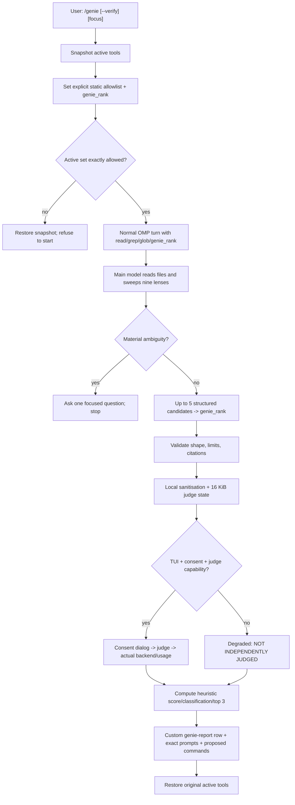

# OMP Genie architecture

Status: implemented and hardened for pre-announcement. Tested host: OMP 19.2.1 on Windows.
Compatibility record: [`compatibility.md`](./compatibility.md). Historical Phase 0 evidence:
[`verification.md`](./verification.md).

## 1. Product boundary

Genie is a user-invoked OMP extension that answers one question:

> Given this project and what its owner appears to be trying to do, what deserves attention next,
> and what exact prompt should I run to investigate or address it?

It is not a code reviewer, task runner, autonomous agent, Jev wrapper, MCP server, or replacement for
OMP's tools. Default `/genie` is static-only. It does not run project scripts, tests, builds, package
managers, git, or `gh`. It does not edit, commit, push, or open PRs.

## 2. Flow



## 3. Host APIs

All citations refer to the installed OMP 19.2.1 source. The extension is an OMP/Pi module, not a
Claude Code extension.

| Need | API | Evidence | Compatibility |
| --- | --- | --- | --- |
| Register commands | `pi.registerCommand(name, { handler })` | `types.ts:1859-1863`, `2098-2107` | Public |
| Start a normal turn | `pi.sendUserMessage(text, { attribution: "agent" })` when idle | `docs/extensions.md:399-408`; `agent-session.ts:11664-11715` | Public; verified |
| Register ranking tool | `pi.registerTool(...)`; `execute(..., ctx)` | `types.ts:1052-1101` | Public |
| Read active tools | `pi.getActiveTools()` | `types.ts:2248-2255` | Public; verified |
| Restrict active tools | `pi.setActiveTools(names)` | `types.ts:2248-2255`; `session-tools.ts:1503-1600` | Public; verified live |
| Block a tool call | `pi.on("tool_call", handler)` returning `{ block, reason }` | `types.ts:1725-1780`; `shared-events.ts:345-366` | Public; verified in tests |
| Read host version | `pi.pi.VERSION` | injected package exports; `extensibility/extensions/types.ts:1944` | Public; verified live |
| Read project paths | `ctx.cwd` | `types.ts:838-839` | Public |
| Consent / picker | `ctx.ui.confirm` / `ctx.ui.select`; gate on `ctx.mode === "tui" && ctx.hasUI` | `types.ts:393-394`, `825-849`; `docs/extensions.md:1044-1049`, `1245-1247` | Public; TUI only |
| Resolve/inspect judge | `resolveJudge({settings, registry, sessionModel, sessionId, purpose})` | `judgment/index.ts:459-461`; `JudgeDeps` `97-135` | Internal package export; capability-gated |
| Live settings | `ctx.modelRegistry.mirrorInputs().settings` | `model-registry.ts:881-883` | Public accessor returning internal shape |
| Judge primary/fallbacks | `primaryModel()`; `config/model-resolver.resolveRoleChain`, `config/model-roles.roleCandidatePool` | `judgment/index.ts:567-574`; `model-resolver.ts:1847-1883` | Internal; fallback list degrades to text |
| One judge request | `judge.withCandidate(...)` / `judge.judge({state, questions})` | `judgment/index.ts:510-578`; `ai/judgment/types.ts:116-143` | Internal; capability-gated |
| Actual backend + usage | `JudgmentResult { api, provider, model, answers, usage }` | `judgment/index.ts:1023-1029` | Required for attribution |

**Version boundary.** Core extension APIs were tested on 19.2.1. The judge adapter is not gated by a
version regex. It is allowed only when every runtime capability check passes. Anything else disables
independent judgement with a visible reason; the core report still works. An untested OMP version is
allowed through the same checks but is labelled **UNTESTED OMP VERSION** in the dialog and report.

## 4. Execution safety

`src/safety.ts` owns the policy:

```text
STATIC_TOOL_ALLOWLIST = read, grep, glob
+ genie_rank
```

OMP 19.2.1 may also add host-managed command tools (`resolve`, `reject`, `propose`, `report_issue`).
They do not run project code. Anything else in the active set after `setActiveTools` is a failure:
Genie restores the snapshot and refuses to start.

Deliberately excluded: `bash`, `eval` (Python/JS), `debug`, `task`, `wait`, `lsp`, `find`,
`web_search`, `write`, `edit`, `ast_edit`, `github`, `checkpoint`, `rewind`, `security_scan`, memory
tools, MCP tools, and all extension tools. `read` can open archives/databases in-process; it does not
execute project code.

`src/extension.ts` snapshots the exact active set before every run and restores it after:

- terminal `agent_end` (`willContinue` and `awaitingAsyncWork` are false);
- `sendUserMessage` failure;
- `session_clear`;
- `session_before_switch`, `session_before_branch`, `session_before_tree` (the transition is
  cancelled if restoration fails);
- `session_shutdown`.

The restore uses the snapshot, so a tool the user had enabled is not removed. A `tool_call` guard
blocks a non-allowlisted tool even if it is somehow invoked. `genie_rank` itself uses `approval:
"read"` and has no filesystem write path.

### Verification proposal mode

`/genie --verify` uses the same static allowlist. The main model may return at most three
`verificationCommands` `{ command, purpose }` objects. The report prints them in fenced blocks and
states that Genie did not execute them.

OMP exposes `tool_call` blocking and approval events, but no extension API to force a normal approval
prompt when the host was launched with `--auto-approve`. An extension could add its own UI confirmation,
but that is a second approval mechanism, not OMP's normal one. The implementation therefore stops at a
proposal and lets the user run the command under their own policy. This is a deliberate fail-closed
choice, not an execution feature.

## 5. Command behaviour

### `/genie [--verify] [focus]`

- Main session only. Unknown options/focus rejected; no turn starts.
- `await ctx.waitForIdle()`.
- Reject a second concurrent Genie run in the same session.
- Parse focus: empty/all or one of `architecture`, `security`, `performance`, `roadmap`, `tests`,
  `dependencies`.
- Load `prompts/genie.md` + `prompts/rubric.md`; inject focus and static/verification mode.
- Snapshot active tools, set the explicit allowlist plus `genie_rank`, read it back, and fail closed
  if anything unexpected remains or `genie_rank` is missing.
- Send the prompt through `pi.sendUserMessage`. On failure, delete the run and restore.
- On terminal end, restore and delete the run.

### `/genie-run [1-3]`

- Main session, TUI only, requires a prior report in the same session.
- With an index, use it. Without, show `ctx.ui.select` over the top-three titles.
- Send the exact stored prompt through `pi.sendUserMessage`. This is the user explicitly running a
  prompt; it is not Genie executing a recommendation and it uses the user's current tools/approval
  policy.
- The last report is held in memory keyed by session id and cleared on switch/clear/shutdown. It is
  not persisted.

## 6. Evidence gathering

`prompts/genie.md` instructs the main model to:

1. Read the project's self-description first: `README*`, docs/roadmap, package manifests, and release
   or test process files.
2. State apparent goals in about three lines and distinguish inspected sources from unavailable ones.
   If an ambiguity would materially change the recommendation, ask one focused question and stop.
3. Sweep nine fixed lenses: correctness, security, architecture, performance, tests/CI, documentation,
   dependencies, roadmap/intent, release/operations. Each is `finding`, `no_finding`,
   `not_inspected`, or `not_applicable`.
4. Propose at most five project-specific, evidence-backed candidates. Generic advice is penalised.
5. Call `genie_rank` exactly once.
6. Present the tool's report; do not re-rank or add findings.

Static mode has no git, `gh`, shell, tests, builds, or network. The model must mark those lenses
`not_inspected` and cannot claim commit history, issue metadata, or a passing test as evidence. This
is a real loss compared with a tool-capable turn.

## 7. Candidate validation

`genie_rank` rejects malformed input with a specific correction message and `isError: true`. Limits:

| Field | Limit |
| --- | --- |
| Candidates | 0–5 |
| Goals summary | 1–1200 chars |
| Lens entries | exactly 9, one per lens |
| Title | 1–160 chars |
| Observed / why it matters / verify-or-do | 1–800 chars each |
| Evidence items per candidate | 0–6 |
| Evidence quote | ≤400 chars |
| Next prompt | 1–4000 chars |
| Owner-decision question | 8–400 chars, 2–5 options |
| What would change ranking | 1–500 chars |
| Verification commands | 0–3, single-line command ≤500 chars, purpose ≤200 chars |

### Citation checks

For evidence items of kind `file`, the tool resolves against `ctx.cwd`, rejects absolute paths outside
it, `..` escapes, symlink escapes, and sensitive/bulky roots (`.git`, `node_modules`, build output,
`.env*`, private keys, credential stores, `secrets.*`, `.npmrc`, `.netrc`, etc.). It reads at most
1 MiB per file and 4 MiB total per call, rejects binary/NUL content, checks line bounds, and requires a
whitespace-normalised quote match inside the cited range.

A candidate with any `missing`/`out_of_range`/`excluded`/`quote_mismatch` item becomes
**CONFLICTING / INSUFFICIENT**. No verified file item means **UNVERIFIED**. Only verified content (or
verified ranges when no quote is available) with no failures can be **VERIFIED**.

## 8. Sanitisation and disclosure

Genie sanitises its own payload; OMP's secret subsystem is not reused.

- **Never sent to the judge:** conversation, full files, tool transcripts, raw `nextPrompt`, system
  prompts, images, binary content.
- **Sent:** project goals, focus, assumptions, lens coverage, and per-candidate title, lens, observed,
  why it matters, verify-or-do, sanitised evidence path/line/quote, citation status.
- **Limits:** 16 KiB total UTF-8; oversize input is rejected, not silently truncated.
- **Path exclusions:** `.env*`, `*.pem`, `*.key`, `*.p12`, `*.pfx`, `id_rsa*`, `id_ed25519*`,
  `.npmrc`, `.pypirc`, `.netrc`, `secrets.*`, credential stores, `.git/`, `node_modules/`, build output,
  binary/oversize files.
- **Content redaction:** common token/key formats, JWTs, Bearer headers, PEM blocks, connection URLs
  with passwords, and conservative password/secret/token assignments. This is best-effort; false
  positives and negatives are possible.

## 9. Consent

One rule everywhere: **no judge transmission without affirmative consent through an available
interactive mechanism, otherwise degrade and send nothing.**

- Requires `ctx.mode === "tui" && ctx.hasUI` and an affirmative `ctx.ui.confirm`.
- The dialog names the primary provider/model/API and sanitised endpoint host, lists configured
  fallback candidates when enumerable, states where OMP takes them when not, lists evidence categories
  and approximate sanitised bytes, and says another provider may answer.
- Declined, no UI, headless, RPC, ACP, no credentials, same-family route, capability failure, partial
  answers, missing attribution, or error: **NOT INDEPENDENTLY JUDGED** with a short reason.
- The actual returned provider/model/API is reported; the primary in the dialog is not assumed to be
  the answerer.
- `/genie` is not consent to send evidence to an additional provider.

## 10. Judge adapter

`src/judge.ts` owns every internal OMP judgement dependency and all capability checks.

- Dynamic import `@oh-my-pi/pi-coding-agent/judgment`; a missing subpath must not break the extension.
- Require `resolveJudge`, live settings, a resolved handle, `withCandidate`/`judge`, `primaryModel`,
  and a provider/model/API/baseUrl.
- Round-trip the adapter's `noul` and `score` question/answer shapes through the interpreter.
- Refuse a primary in the active model's family.
- Enumerate fallbacks through the user's own settings:
  `config/model-roles.roleCandidatePool("judge", settings, registry)` and
  `config/model-resolver.resolveRoleChain("judge", settings, pool)`. If those internal subpaths are
  unavailable, keep the judge and show the textual route
  (`modelRoles.judge` → `retry.fallbackChains.judge` / role defaults → session-model fallback).
- Call `withCandidate` with one state and all questions; report the returned `kind` (`native` / prompted).
- Require every expected answer id, plus non-empty `api`, `provider`, and `model`. Missing anything is
  degraded, never partially invented.
- Report usage/cost returned by the judge and state that it is not in OMP's session ledger.
- On an untested OMP version, allow only if all checks pass and label **UNTESTED OMP VERSION**.

Judge questions per candidate:

- `noul`: would this apply to almost any repository? (generic control)
- `noul`: does the supplied evidence support the observation? (evidence-support downgrade)
- `score`: how much would this improve the stated goals? (advisory/display-only; not scored)

## 11. Scoring and classification

Impact, alignment, and feasibility are main-model inputs (75% combined); evidence strength is computed
by code from citation checks (25%). The judge is secondary: it can cap a generic item and downgrade
evidence support. Its impact rating is advisory/display-only and does not enter the total.

The unused judge impact question is retained deliberately: it is displayed as an independent second
opinion beside the main model's impact, and removing it would change the report surface and require a
fresh evaluation. It is not a hidden score input, and no formula change was made to make the judge
look influential.

| Component | Weight | Formula |
| --- | ---: | --- |
| Impact | 30 | `((impact - 1) / 4) * 30` |
| Alignment | 30 | `((alignment - 1) / 4) * 30` |
| Evidence strength | 25 | `((strength - 1) / 4) * 25` |
| Feasibility | 15 | `((feasibility - 1) / 4) * 15` |
| **Total** | **100** | rounded sum |

Evidence strength: 5 = three or more verified quotes; 4 = two verified quotes; 3 = one verified quote
or two verified ranges; 2 = one verified range; 1 = no verified file citation.

**Generic cap:** independent `generic ≥ 0.65` caps at 40 and is labelled independent. In degraded mode
only, `genericRisk ≥ 0.70` applies the same cap and is labelled self-assessment.

**Evidence support:** independent `support ≤ 0.35` downgrades to **CONFLICTING / INSUFFICIENT**, shown
as a disagreement.

**Classification order:**

1. Valid `ownerDecision` and score ≥ 50 → **OWNER DECISION REQUIRED**.
2. Score ≥ 70 and impact ≥ 4 → **MUST FIX / VERIFY NOW**.
3. Otherwise → **FUTURE WORK**.

The label is always **Priority score (heuristic)**. It is not a probability, expected value, or
calibrated risk.

## 12. Output

At most the top three by final score. The report contains:

- execution mode, OMP version, main model;
- focus, goals, assumptions, inspected/not-inspected lenses;
- proposed verification commands in `--verify` mode (not executed);
- per recommendation: title, classification, evidence status, heuristic score and components,
  citations and checks, why it matters, verification step, exact next prompt, main-model confidence
  (self-assessment), independent judge details or **NOT INDEPENDENTLY JUDGED**, remaining uncertainty,
  and what would change the ranking;
- a footer pointing to `/genie-run <n>` in the TUI and the heuristic disclaimer.

The tool also queues the same report as a custom `genie-report` row via `pi.sendMessage(...,
excludeFromContext: true)`, so the authoritative report is visible even if the model paraphrases.

## 13. Failure handling

| Failure | Behaviour |
| --- | --- |
| Unknown option/focus | Notify; no turn. |
| Concurrent Genie run | Notify; no second run. |
| Tool restriction fails or leaves an unexpected tool | Restore snapshot; refuse to start. |
| `sendUserMessage` rejected | Restore snapshot; notify. |
| Model asks a material question | One question, no ranking; user reruns. |
| No candidates | "No evidence-backed candidates met the bar"; no padding. |
| Invalid/oversize candidate | Tool error with correction; model may retry once. |
| Citation failed | Downgrade; never claim verified; continue. |
| Judge import/settings/method/shape fail | Degraded with capability reason. |
| Judge no credentials/model | Degraded. |
| Judge declines/no UI | Degraded; nothing sent. |
| Judge same family as active | Degraded; not independent. |
| Judge partial/missing answer id | Degraded; no invented scores. |
| Judge result missing provider/model/API | Degraded; unattributed. |
| Custom report row fails | Tool result still carries the report. |
| Restore fails on session transition | Cancel the transition and notify. |
| User abort | Abort propagation; terminal end restores. |

Degraded reports always say **NOT INDEPENDENTLY JUDGED** and never show invented judge scores,
backends, probabilities, usage, or cost.

## 14. Privacy and side effects

- The main provider receives what the main model reads, as in any OMP turn.
- The judge receives only the sanitised, bounded payload, only after affirmative interactive consent.
- Redaction is best-effort; it is not comprehensive secret detection.
- No telemetry, analytics, background timers, persistent recommendation database, or file writes.
- Local file reads are bounded, read-only, inside `ctx.cwd`, and never logged.
- In-memory last-result storage contains titles, classifications, exact prompts, and proposed commands.

## 15. Installation and compatibility

Source/local installation only; no npm publish.

1. One-off: `omp -e <repo>/src/extension.ts`.
2. Local plugin: `omp plugin install <repo-path>`; remove with `omp plugin uninstall omp-genie`.
3. Or copy into `<cwd>/.omp/extensions` / `~/.omp/agent/extensions`.

See [`compatibility.md`](./compatibility.md) for tested, expected-unverified, probe-passed,
untested-with-warning, and capability-failing versions.

No Claude Code compatibility claim. OMP can consume Claude plugin content, but extension modules
import OMP/Pi host packages.

## 16. Deliberately not built

No MCP server, vector database, orchestration framework, multi-agent system, Jev integration,
automatic repository changes, commits/PRs/deployments, background hooks/scheduled analysis,
persistent recommendation database/cache, separate auth/provider layer, telemetry, automatic
follow-up execution, or in-extension verification command execution.

## 17. Tests

Deterministic (no model):

- candidate validation and limits, including verification-command shape;
- citation path/range/quote checks, symlink/escape/deny-list cases;
- secret pattern redaction and false-positive cases;
- size limits;
- scoring formula, evidence strength, generic cap, classification order;
- evidence-status downgrade and unverified prompt prefix;
- consent refusal/no-UI/degraded mode using a mocked judge;
- answer-id validation, attribution rejection, endpoint host sanitisation;
- backend attribution and partial-answer handling;
- static allowlist parsing, fail-closed activation, tool-call blocking, restoration after
  completion/continue/failure/switch;
- verification mode never activating an execution tool;
- report sanitisation and verification-command section.

Host/live (opt-in):

- extension loads in `omp` and registers `/genie`, `/genie-run`, `genie_rank`;
- default static-only run with a marker-writing fixture and `--auto-approve`;
- verification-proposal run with the same fixture;
- judge capability probe on 19.2.1;
- owner acceptance script for a real consent-based judge call (not run in this pass);
- Genie vs plain-prompt fixture suite.

Model-quality evaluation is opt-in. Fixtures and ground truth are separate; the harness must not let
Genie or the baseline read the answer key. Metrics and denominators are in [`evals.md`](./evals.md);
no statistical significance or calibration claims.
